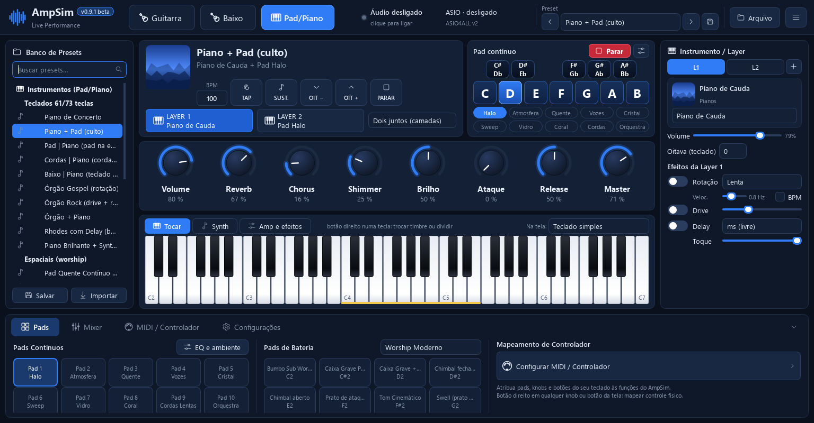
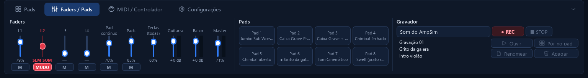
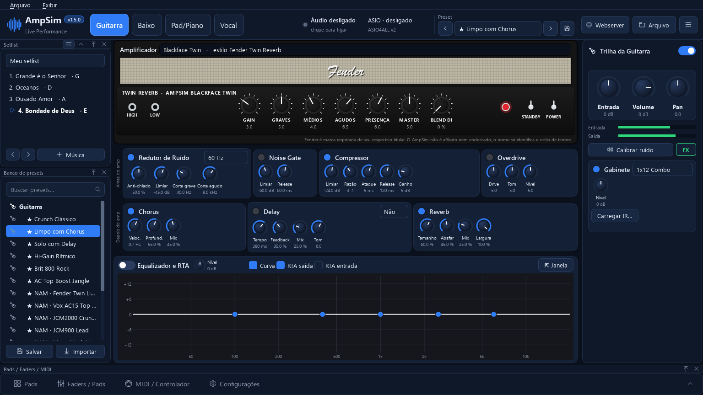

# AmpSim — o canivete suíço de som para comunidades

**Amplificador de guitarra e baixo, pads de louvor, pianos, órgãos e bateria nos pads — tudo
gratuito, rodando no computador que você já tem.**

O AmpSim nasceu para ajudar **igrejas, ministérios de louvor, projetos sociais, escolas de
música e bandas com orçamento apertado**. Em vez de pedaleiras, amplificadores, módulos de
som e assinaturas de bibliotecas caras, um notebook com uma placa de som simples (ou até a
entrada de microfone USB mais barata) e um teclado controlador de entrada já resolvem:

- 🎸 **Guitarra e baixo** com amplificadores inspirados nos clássicos, capturas de amplificadores
  reais (Neural Amp Modeler), gabinetes, pedais e efeitos.
- 🎹 **Pad/Piano**: pianos, Rhodes, órgãos com rotação (Leslie), cordas, pads espaciais com
  Shimmer, baixo pulsante no BPM — com **camada** e **divisão de teclado** (baixo na mão esquerda).
- 🥁 **Pads de bateria worship**: bumbos sub, caixas graves, palmas, chimbais, swells; e
  **pad contínuo** no tom da música (aquele "tapete" que segura o louvor).
- 🎛️ **Funciona com qualquer teclado MIDI**: mapeie knobs, faders e botões em segundos,
  vendo na tela qual controle físico você está mexendo.

Todos os timbres usados são **gratuitos e de licença livre**, e o AmpSim é **software livre
(GPL-3.0)**.

> **Os timbres são exemplos.** Os nomes e desenhos de amplificadores e teclados (Marshall,
> Fender, Yamaha, Roland…) são **homenagens** que indicam o *estilo* que inspirou a tela. **O som
> não é cópia nem amostra dos equipamentos originais.** Os sons foram criados pelo próprio AmpSim
> ou vêm de bancos gratuitos, e o AmpSim não tem relação com esses fabricantes.



---

## Sumário

1. [Instalação (passo a passo)](#instalação-passo-a-passo)
2. [Primeiro uso: escolhendo a placa de som](#primeiro-uso-escolhendo-a-placa-de-som)
3. [Guitarra e Baixo](#guitarra-e-baixo)
4. [Pad/Piano](#padpiano)
5. [Ao vivo: setlist, metrônomo e saúde do áudio](#ao-vivo-setlist-metrônomo-e-saúde-do-áudio)
6. [Tela remota no celular ou tablet (Webserver)](#tela-remota-no-celular-ou-tablet-webserver)
7. [Compartilhar cenas e presets (menu Arquivo)](#compartilhar-cenas-e-presets-menu-arquivo)
8. [Mapeando o seu controlador MIDI](#mapeando-o-seu-controlador-midi)
9. [Latência: dicas para tocar sem atraso](#latência-dicas-para-tocar-sem-atraso)
10. [Problemas comuns](#problemas-comuns)
11. [Para quem quer mexer no código](#para-quem-quer-mexer-no-código)
12. [Licenças, créditos e marcas](#licenças-créditos-e-marcas)

---

## Instalação (passo a passo)

**Você precisa de:** Windows 10 ou 11 (64 bits), ~700 MB livres (mais os pianos que escolher) e
internet na instalação.

### Jeito fácil: o instalador (recomendado)

1. Abra **https://github.com/MarcelinoJunior/ampsim/releases**, pegue a versão mais nova e baixe o
   arquivo **`AmpSim-Setup-<versão>.exe`**.
2. Dê duplo-clique. O Windows pode mostrar “O Windows protegeu o computador” (o instalador não tem
   certificado pago): clique em **Mais informações → Executar assim mesmo**.
3. Escolha o que quer junto:

   | Opção | O que é |
   |---|---|
   | Pianos gravados | Piano de Armário (44 MB) e Piano de Cauda YDP (52 MB) já vêm marcados; o Salamander (296 MB, o melhor) é opcional. Todos podem ser baixados depois na tela **Timbres adicionais** |
   | FlexASIO / ASIO4ALL | Drivers ASIO gratuitos, baixados dos sites oficiais. Só para quem não tem driver ASIO da própria placa (Focusrite, Behringer, Yamaha…) |

4. No fim ele prepara o áudio (cerca de 1 minuto, só na instalação) e abre o AmpSim.

Não precisa de Python nem de permissão de administrador: tudo fica em
`%LOCALAPPDATA%\Programs\AmpSim` e sai pelo **Adicionar ou remover programas** do Windows.

### Pelo código (para quem quer mexer no projeto)

1. Baixe o projeto em **https://github.com/MarcelinoJunior/ampsim** (botão verde *Code →
   Download ZIP*) e extraia numa pasta de **caminho curto**, por exemplo `C:\AmpSim`. Quem usa
   git pode fazer `git clone https://github.com/MarcelinoJunior/ampsim.git C:\AmpSim`.
2. Dê **duplo-clique em `instalar.bat`**. Ele faz tudo sozinho:

   | Passo | O que acontece |
   |---|---|
   | 1 | Instala o **Python 3.13** pelo `winget` (se você ainda não tiver Python 3.11+) |
   | 2 | Cria o ambiente `.venv` e instala as bibliotecas do `requirements.txt` |
   | 3 | Baixa os timbres e motores gratuitos (~33 MB): FluidSynth, banco GeneralUser GS e capturas NAM, da cópia mantida no GitHub do AmpSim |
   | 4 | Pergunta se quer instalar um **driver ASIO gratuito**: ASIO4ALL ou FlexASIO (pelo `winget`) |
   | 5 | Prepara o DSP (≈30 s, só na primeira vez) e cria o atalho **AmpSim** na Área de Trabalho |

3. Abra pelo atalho **AmpSim** (ou `run.bat`).

> O Python e os drivers vêm das **fontes oficiais** (winget). Os timbres e motores vêm de uma
> **cópia mantida no próprio GitHub do AmpSim**, no release
> [extras-1](https://github.com/MarcelinoJunior/ampsim/releases/tag/extras-1), conferida por
> SHA-256. Assim, se algum projeto mudar o lugar dos arquivos, a instalação continua
> funcionando. Se essa cópia falhar, o instalador busca em cada fonte oficial. Os arquivos ficam
> fora do código para as atualizações continuarem leves.

<details>
<summary>Instalação manual (sem o instalador)</summary>

```bat
winget install -e --id Python.Python.3.13
python -m venv .venv
.venv\Scripts\pip install -r requirements.txt
.venv\Scripts\python tools\baixar_extras.py
winget install -e --id MichaelTippach.ASIO4ALL
.venv\Scripts\python -m ampsim
```
</details>

### Atualizações

O AmpSim se atualiza sozinho. Ao abrir, ele confere o GitHub em segundo plano; se houver versão
nova, baixa e instala sem parar o som. Depois aparece o botão **Reiniciar para atualizar** na
barra de cima. A sessão é salva e o programa abre de novo já na versão nova.

- **Instalado pelo instalador:** baixa o instalador da versão nova (conferido por SHA-256); o
  **Reiniciar para atualizar** roda o instalador em silêncio, que atualiza e abre o AmpSim de novo.

- **Baixado em ZIP:** os arquivos do programa são trocados. A pasta `.venv` (bibliotecas) e a
  `third_party` (timbres) ficam como estão.
- **Instalado com git clone:** usa `git pull` só para avançar (fast-forward). Uma cópia com
  mudanças suas não é tocada.
- **Bibliotecas:** se a versão nova pedir bibliotecas novas, elas são instaladas no `.venv`.

Para desligar, ou para verificar na hora, use **Configurações → Atualizações**.

## Primeiro uso: escolhendo a placa de som

1. Clique na placa/latência no topo (ou ☰ → **Placa de som e driver…**).
2. **API de áudio**: use **ASIO** (menor atraso). Sem ASIO, use **Windows WASAPI** com
   "modo exclusivo", ou **WDM-KS**.
3. Escolha a **Entrada** (onde a guitarra/baixo está plugada) e a **Saída** (fone/caixa).
4. **Canal da guitarra / do baixo**: em placas com uma entrada só, use *Entrada 1* nos dois e
   deixe ativa só a trilha que estiver usando.
5. **Buffer**: comece com **128**. Se ouvir estalos, suba para 256; se quiser menos atraso,
   tente 64.
6. Clique em **Aplicar e iniciar**.

Com **ASIO4ALL**, abra **Painel do driver ASIO…** e, na chave inglesa, ligue a entrada e a
saída da sua placa (e desligue as outras). Se a saída aparecer como "Not Connected", nada sai
no fone — é só ligá-la no painel.

**Som saindo pelo próprio teclado** (saída P10 / fones de um M-VAVE SMK-25, Yamaha PSR-E473 ou
Roland VR-730 ligado pelo USB). Há dois caminhos:

- **Configurações → "Usar a saída do teclado (P10 / fones)…"**: procura esses modelos entre as
  saídas de áudio do Windows. Dá preferência ao que estiver escolhido em "Na tela".
- **Conectar com o AmpSim aberto**: se o Windows reconhecer o aparelho como placa de som, o
  AmpSim pergunta se o som deve sair por ele e abre a configuração já com a saída escolhida. É
  só conferir e clicar em **Aplicar e iniciar**. Se nenhum teclado MIDI estiver escolhido, o novo
  já fica ativo.

Se o aparelho não aparecer em Configurações do Windows → Som → Saída, ele só manda MIDI, e o som
continua saindo pela placa do computador. Alguns fabricantes oferecem driver de áudio USB
próprio para o modelo.

## A tela

Todas as abas seguem o mesmo desenho:

| Onde | O que tem |
|---|---|
| **Barra de cima** | abas **Guitarra · Baixo · Pad/Piano**; o estado do áudio (clique para ligar/desligar); a placa e a latência (clique para configurar); o **Preset** da aba com **‹ ›** e o botão de salvar; **Arquivo** e o menu **☰** |
| **Banco de Presets** (esquerda) | busca e lista de tudo: timbres do Pad/Piano (prontos e os seus), presets de Guitarra e Baixo, amp/efeitos das teclas e os arquivos `.ampsim` de Documentos\AmpSim. Botão direito num item: exportar, copiar código, excluir |
| **Centro** | a aba aberta |
| **Painel da direita** | **Instrumento / Layer** no Pad/Piano; trilha e gabinete na Guitarra/Baixo |
| **Barra de baixo** | **Pads** (pads contínuos e de bateria), **Faders / Pads** (faders com mute de emergência, os 8 pads e o gravador: REC/STOP grava o som do AmpSim ou uma entrada, e a gravação vai para um pad), **MIDI / Controlador** e **Configurações**. A seta à direita recolhe a barra; cada aba lembra se ela fica aberta ou fechada |
| **Teclas de atalho** | Alt+Espaço: mute geral (faixa vermelha “SEM SOM”) · Alt+1 a Alt+4: mute das camadas · Alt+P / Alt+B: mute do pad contínuo / dos pads · Ctrl+→ / Ctrl+←: próximo / anterior preset · F1 F2 F3: abas · Esc: pânico · Ctrl+R: gravar · Ctrl+T: tap tempo · Ctrl+Espaço: parar o pad. Troque em Configurações → Teclas de atalho |



## Guitarra e Baixo



- **Amplificador** (seletor único no topo): 7 modelos inspirados em clássicos (Blackface Twin,
  Brit Plexi, Brit 800, AC Top Boost, Recto Modern, SVT Classic, Bass Drive), **capturas NAM**
  de amplificadores reais, **plugins VST3** ou "sem amplificador".
- **Gabinete**: 6 modelos ou um **IR em .wav**.
- **Antes do amp**: Redutor de Ruído (anti-hum 60 Hz, anti-chiado), Noise Gate, Compressor,
  Overdrive. **Depois do amp**: EQ, Chorus, Delay, Reverb.
- **Calibrar ruído**: abafe as cordas e clique — o app mede o chiado da sua entrada e ajusta
  o gate sozinho (essencial em entradas de microfone USB simples).
- **Trilha** (à direita): liga/desliga, Entrada, Volume, Pan, medidores e o **Gabinete**.
- **Equalizador e RTA** embaixo dos pedais (some enquanto a barra de baixo está aberta; feche-a
  ou use **⇱ Janela**):
  - arraste os pontos para mexer no Equalizador; duplo-clique zera a banda;
  - veja o espectro da **saída** (só desta trilha) e, se quiser, o da **entrada** seca, para
    comparar;
  - **⇱ Janela** abre o analisador numa janela separada, e fechar a janela devolve o analisador
    para a tela.
- **Presets** de fábrica (★) e os seus: **‹ ›** na barra de cima para trocar e o disquete para
  salvar.

## Pad/Piano

- **Cabeçalho**: o timbre atual, o BPM e os botões **TAP**, **SUST.** (sustain), **OIT −/+** e
  **PARAR** (solta tudo); embaixo, **Layer 1 / Layer 2** e o modo do teclado.
- **Pad contínuo**: os botões grandes **C D E F G A B Parar** ligam o "tapete" no tom.
- **Knobs grandes**: Volume, Reverb, Chorus, Shimmer, Brilho, Ataque, Release e Master.
- **Teclado** na tela. Em **Na tela** dá para trocar pelo desenho de um controlador (M-VAVE
  SMK-25, Yamaha PSR-E473, Roland VR-730), em homenagem aos originais.
- **Instrumento / Layer** (direita): botões **L1 · L2 · L3 · L4** e **+** para adicionar
  camadas (até 4). Em cada camada você escolhe:
  - timbre, volume e oitava;
  - liga/desliga;
  - zona do teclado: teclado todo, mão esquerda ou mão direita (para as camadas 3 e 4);
  - **efeitos próprios**: Rotação, Drive e Delay. Dá para ter rotação só no órgão e delay só no
    piano, por exemplo.

  **Rotação**: Lenta/Rápida como num Leslie (acelera e freia aos poucos). O slider **Veloc.**
  ajusta a velocidade de cada modo. Com **BPM** marcado, ela acompanha o andamento, em voltas
  por tempo. Os controles MIDI de efeito agem na camada escolhida no painel.
- **Tocar · Synth · Amp e efeitos**: troca entre tocar, o Synth AmpSim (pads e baixo pulsante)
  e o amplificador/efeitos da trilha das teclas.

Qualquer knob ou botão da tela pode ir para um controle do seu teclado: **botão direito →
Mapear controle físico…**.

**Timbres prontos** (Banco de Presets ou **‹ ›** lá em cima), por exemplo:

- *Teclados 61/73 teclas*: Piano de Concerto, Piano + Pad (culto), Pad | Piano, Cordas | Piano,
  Órgão Gospel (rotação), Órgão Rock (drive + rotação rápida), Rhodes com Delay…
- *Espaciais (worship)*: **Pad Quente Contínuo (nas teclas)**, que é o som do pad contínuo
  tocado no teclado, Pad Celestial (Shimmer), Céu Aberto, Coral Etéreo, Piano Ambient…
- *Baixo na mão esquerda*: Baixo | Piano, **Baixo Pulsante | Pad (BPM)**…

**Um timbre, dois juntos ou teclado dividido**: em **Teclado**, escolha *Um timbre*, *Dois
juntos (camadas)* ou *Dividido (esq. | dir.)*. No modo dividido aparecem os campos **Mão
direita** e **Mão esquerda**. O desenho do teclado pinta a zona da mão esquerda e mostra o
timbre de cada lado.

O jeito mais rápido é **clicar com o botão direito numa tecla do desenho**. O menu deixa:
- trocar o timbre daquela zona;
- dividir o teclado naquela nota;
- voltar para um timbre só.

**Efeitos das teclas**: Reverb, Chorus, **Shimmer**, **Rotação** (Leslie lenta/rápida),
**Drive**, **Delay** (tempo livre ou no BPM: 1/4, 1/8, 1/8 pontuada…), Ataque, Release, Brilho
e **Sensibilidade ao toque**.

**BPM da música + Tap**: o Baixo Pulsante e o delay no tempo seguem o andamento — digite ou
clique *Tap* no ritmo.

**Pads de bateria (banco A)**: botão direito num pad para escolher entre ~100 sons (com busca
e prévia). Presets: Worship Moderno, Worship Sala Grande, Acústico, Cinemático, Balada Pop…

**Pad contínuo (banco B)**: cada pad liga o "tapete" no tom (C, D, E…); trocar de tom faz
transição suave; *Parar* encerra com fade. Para abrir o **EQ do pad contínuo**, clique com o
botão direito num pad B (ou no botão **EQ…** ao lado do timbre). Dá para:
- cortar graves e agudos (24 dB/oitava), para tirar os harmônicos que embolam com o baixo ou
  brigam com a voz;
- ajustar graves, médios e agudos;
- mudar a largura estéreo;
- escolher quais notas o pad toca (com ou sem a oitava grave);
- ajustar reverb, chorus, shimmer e os tempos de entrada e saída.

Há atalhos prontos como *Sem embolar* e *Atrás da banda*.

**Teclado do PC** também toca: `A W S E D F T G Y H U J K O L P Ç` (Z/X oitava, C/V força).

## Ao vivo: setlist, metrônomo e saúde do áudio

- **Setlist** (topo da lateral esquerda): monte a ordem do culto. **+ Música** guarda o som de
  agora (timbres, camadas, efeitos, BPM, pad contínuo e pads) com o nome da música; clicar na
  música carrega tudo de uma vez. Se o pad contínuo estiver tocando, ele vai para o tom da música.
  Arraste para mudar a ordem; **◀ ▶**, **Ctrl+PgUp / Ctrl+PgDn** ou um botão/pedal do
  controlador ("Próxima música") trocam de música. Dá para ter vários setlists.
- **Metrônomo:** botão **CLICK** ao lado do TAP (Ctrl+M; botão direito: volume e compasso). Em
  **Placa de som e driver → Saída do metrônomo**, mande o click para um par de saídas livre da
  placa (ex.: 3-4 nos fones da banda): ele não vaza para o PA.
- **Saúde do áudio:** ao lado da placa, na barra de cima, **● sem falhas** (verde) ou **● N falhas**
  (amarelo/vermelho) no último minuto; clique para ver o histórico e dicas. Se o cabo USB soltar,
  o AmpSim avisa "Áudio caiu" e religa sozinho quando a placa voltar.
- **Pad que segue o acorde** (aba Pads): o tom do pad contínuo acompanha o acorde da mão esquerda
  (abaixo do ponto de divisão), na hora ou na próxima batida do BPM.
- **Pianos gravados** (menu ☰ → Timbres adicionais): Piano de Armário, Piano de Cauda YDP e
  Salamander (Yamaha C5), baixados quando você quiser.

## Tela remota no celular ou tablet (Webserver)

Use um celular, tablet ou outro computador **na mesma rede Wi-Fi** como segunda tela do AmpSim,
direto no navegador (sem instalar nada no aparelho):

1. Clique em **Webserver** na barra de cima e marque **Ligar a tela remota**.
2. Aponte a câmera do celular para o **QR code** (ou digite o link que aparece, ex.
   `http://192.168.0.10:8080`). Na primeira vez o Windows pode perguntar sobre o Firewall:
   permita em **Redes privadas**.
3. Pronto: no celular aparecem abas embaixo (**Pads, Faders, Setlist, Tempo, Mute, Timbre**); no
   tablet deitado e no PC, tudo lado a lado.

O que dá para fazer pelo aparelho: pad contínuo (tom, timbre, parar) e pads de bateria; faders com
**MUTE** de cada canal; escolher a música da setlist (◀ ▶); BPM, **TAP** e click; **MUTE GERAL** e
**PÂNICO**; trocar o preset do Pad/Piano. Tudo vale na hora nos dois lados, e vários aparelhos
podem ficar conectados ao mesmo tempo. O número no canto (ex. *4 ms*) é o atraso da rede.

**Quem vê o quê:** sem senha, qualquer aparelho na rede entra e vê as telas marcadas. Com **usuário
e senha**, crie um usuário para cada pessoa (ex.: *baterista* só com Pads e Tempo, *mesa* com
Faders e Mute) ou use **Espelho** para ver tudo. Em rede aberta (de visitantes), prefira com senha.
A página funciona só dentro da sua rede, não fica na internet. A porta (8080) pode ser trocada na
mesma janela se outro programa já usar.

## Compartilhar cenas e presets (menu Arquivo)

No botão **☰ Arquivo**:

| Opção | O que faz |
|---|---|
| **Salvar cena…** (Ctrl+S) | Guarda tudo o que é som num arquivo `.ampsim`: amps, pedais, timbres, pads, EQ do pad e master. Não guarda a sua placa de áudio nem o mapeamento do seu controlador. |
| **Exportar preset** | Só uma parte: Guitarra, Baixo, Pad/Piano (amp e efeitos) ou os timbres do teclado |
| **Abrir cena ou preset…** (Ctrl+O) | Abre um `.ampsim` recebido. Antes de aplicar, mostra o nome e o autor. |
| **Copiar código para compartilhar** | Gera uma linha de texto (`AMPSIM1:…`) para colar no WhatsApp, num grupo, numa legenda ou num comentário |
| **Colar código recebido…** | Aplica um código colado |

Os arquivos ficam em **Documentos\AmpSim**, prontos para anexar.

Tudo o que vem de fora é conferido antes de entrar:
- só valores conhecidos e dentro da faixa;
- nenhum caminho de arquivo de outro computador;
- plugins VST3 só se já estiverem instalados no seu PC;
- capturas NAM procuradas pelo nome nas suas pastas, com aviso se faltar alguma.

## Mapeando o seu controlador MIDI

1. Conecte o teclado pelo **USB** e escolha-o em **MIDI / Controlador** (barra de baixo).
2. **Qualquer teclado**: em qualquer knob ou botão da tela, clique com o **botão direito →
   Mapear controle físico…**. Abre um **medidor ao vivo** que mostra cada knob, fader ou botão
   que você mexe. O último movido fica selecionado: é só confirmar.
3. **Controlador com pads e knobs** (ex.: SMK-25): **Mapear meu controlador (assistente)…** pede
   um controle de cada vez ("toque o PAD 1", "gire o KNOB 1"…). Na mesma aba você escolhe a
   função de cada knob e botão.

## Latência: dicas para tocar sem atraso

- Prefira **ASIO**; feche outros programas de áudio (no ASIO só um programa usa a placa).
- Buffer 64–128 a 48 kHz dá ~3–6 ms por trecho. A barra do topo mostra a latência real e a
  carga de CPU. Passe o mouse no estado do áudio para ver as **falhas** (estalos). Se houver
  falhas, aumente o buffer.
- Notebook na tomada e no modo de energia "Melhor desempenho".

## Problemas comuns

| Sintoma | O que fazer |
|---|---|
| Não sai som da guitarra | Veja o **Volume** da trilha (se aparecer "mudo", dê duplo-clique no knob) e se o medidor **in** se mexe |
| Zumbido/chiado agudo | **Calibrar ruído**; abaixe o ganho de entrada; ligue o Redutor de Ruído |
| "Dispositivo indisponível" | Feche outros programas de áudio; no ASIO4ALL, ligue a saída da placa no painel |
| Teclado do PC não toca | Em **Configurações**, marque "Teclado do PC toca as notas" e deixe a janela do AmpSim em primeiro plano |
| Estalos | Aumente o buffer; verifique o contador de falhas no topo |
| Erro inesperado | Veja `%APPDATA%\AmpSim\error.log` |

## Para quem quer mexer no código


Python 3.11+ com **Numba** (DSP compilado para código nativo), **PySide6** (interface),
**sounddevice/PortAudio** (ASIO/WASAPI/WDM-KS), **FluidSynth** (timbres SoundFont),
**SciPy/BLAS** (capturas NAM) e **pedalboard** (plugins VST3).

```
ampsim/
  audio/      motor de áudio, dispositivos, FluidSynth, VST3
  dsp/        amplificadores, efeitos, NAM, synth, bateria worship, efeitos das teclas
  midi/       entrada MIDI nativa do Windows
  web/        tela remota: servidor da página (websockets) e a página do celular (web/static)
  ui/         interface (barra superior, banco de presets, Pad/Piano, guitarra/baixo, barra inferior)
  instruments.py   timbres, pads, mapeamento do controlador
tools/        baixar_extras.py (timbres gratuitos), make_icon.py
tests/        testes automáticos (DSP, estabilidade, cliques, latência de CPU)
```

Testes (áudio, estalos, compartilhamento e a interface inteira, sem abrir janela):
`.venv\Scripts\pip install pytest` e `.venv\Scripts\python -m pytest`.

Contribuições são bem-vindas — especialmente **novos timbres gratuitos**, presets de louvor
e traduções.

## Licenças, créditos e marcas

**Código do AmpSim:** [GNU GPL-3.0](LICENSE). Você pode usar, estudar, copiar, modificar e
distribuir o AmpSim, inclusive em igrejas, escolas e projetos sociais, desde que versões
modificadas continuem com o código aberto sob a mesma licença. A lista completa de créditos e
licenças de terceiros está em [CREDITS.md](CREDITS.md).

Componentes de terceiros (baixados pelo instalador, fora do repositório):

| Componente | Licença |
|---|---|
| [FluidSynth](https://github.com/FluidSynth/fluidsynth) | LGPL-2.1 (carregado como DLL) |
| [GeneralUser GS](https://github.com/mrbumpy409/GeneralUser-GS) — S. Christian Collins | licença própria, uso livre inclusive comercial |
| [Capturas NAM](https://github.com/pelennor2170/NAM_models) | GPL-3.0 |
| [Neural Amp Modeler](https://github.com/sdatkinson/NeuralAmpModelerPlugin) (plugin, opcional) | MIT |
| [pedalboard](https://github.com/spotify/pedalboard) (Spotify) | GPL-3.0 |
| [sounddevice](https://github.com/spatialaudio/python-sounddevice) / PortAudio | MIT |
| ASIO4ALL / FlexASIO (opcionais) | freeware / MIT |

### Marcas registradas

Fender, Marshall, Mesa/Boogie, Vox, Ampeg, Orange, EVH, Soldano, Tech 21, M-VAVE, Yamaha,
Roland e demais nomes de equipamentos citados são marcas de seus respectivos titulares. O
AmpSim **não é afiliado, patrocinado nem endossado** por nenhum deles. Os nomes servem apenas
para identificar o estilo de timbre ou o equipamento capturado. As fachadas e os instrumentos
desenhados são **homenagens** aos originais, desenhadas do zero no código, sem usar fotos ou
arquivos oficiais. Marcas, logotipos e imagens pertencem aos titulares, e cada tela exibe esse
aviso.

**Os timbres são exemplos e não têm relação com o som dos originais.** Nenhum som do AmpSim foi
gravado ou extraído desses equipamentos. Eles foram criados pelo programa (synth, bateria,
reverbs) ou vêm de bancos gratuitos como o GeneralUser GS.
