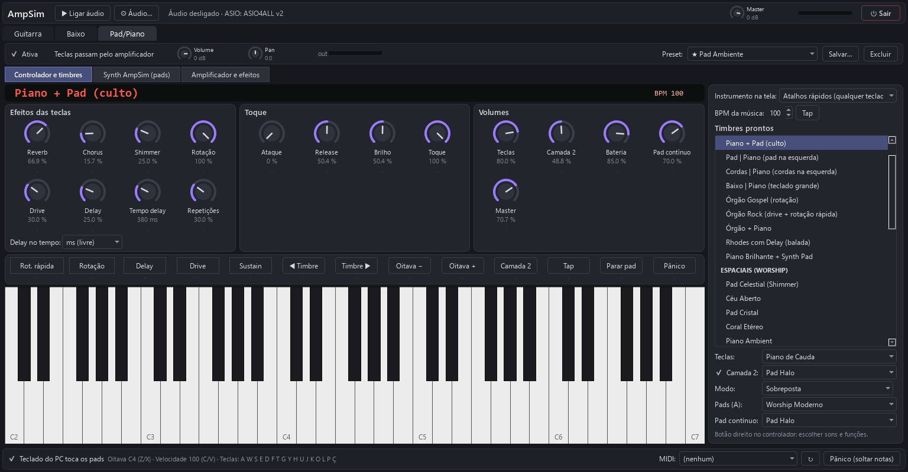

# AmpSim — o canivete suíço de som para comunidades

**Amplificador de guitarra e baixo, pads de louvor, pianos, órgãos e bateria nos pads — tudo
gratuito, rodando no computador que você já tem.**

O AmpSim nasceu para ajudar **igrejas, ministérios de louvor, projetos sociais, escolas de
música e bandas com orçamento apertado**. Em vez de pedaleiras, amplificadores, módulos de
som e assinaturas de bibliotecas caras, um notebook com uma placa de som simples (ou até a
entrada de microfone USB mais barata) e um teclado controlador de entrada já resolvem:

- 🎸 **Guitarra e baixo** com amplificadores inspirados nos clássicos, capturas de amplificadores
  reais (Neural Amp Modeler), gabinetes, pedais e efeitos.
- 🎹 **Pad/Piano**: pianos, Rhodes, órgãos com rotação (Leslie), cordas, pads espaciais com
  Shimmer, baixo pulsante no BPM — com **camada** e **divisão de teclado** (baixo na mão esquerda).
- 🥁 **Pads de bateria worship**: bumbos sub, caixas graves, palmas, chimbais, swells; e
  **pad contínuo** no tom da música (aquele "tapete" que segura o louvor).
- 🎛️ **Funciona com qualquer teclado MIDI**: mapeie knobs, faders e botões em segundos,
  vendo na tela qual controle físico você está mexendo.

Todos os timbres usados são **gratuitos e de licença livre**. A licença do código do
AmpSim ainda será definida (veja o final deste arquivo).


---

## Sumário

1. [Instalação (passo a passo)](#instalação-passo-a-passo)
2. [Primeiro uso: escolhendo a placa de som](#primeiro-uso-escolhendo-a-placa-de-som)
3. [Guitarra e Baixo](#guitarra-e-baixo)
4. [Pad/Piano](#padpiano)
5. [Mapeando o seu controlador MIDI](#mapeando-o-seu-controlador-midi)
6. [Latência: dicas para tocar sem atraso](#latência-dicas-para-tocar-sem-atraso)
7. [Problemas comuns](#problemas-comuns)
8. [Para quem quer mexer no código](#para-quem-quer-mexer-no-código)
9. [Licenças, créditos e marcas](#licenças-créditos-e-marcas)

---

## Instalação (passo a passo)

**Você precisa de:** Windows 10 ou 11, ~1,5 GB livres e internet só na instalação.

1. Baixe este projeto (botão *Code → Download ZIP* ou `git clone`) e coloque numa pasta de
   **caminho curto**, por exemplo `C:\AmpSim`.
2. Dê **duplo-clique em `instalar.bat`**. Ele faz tudo sozinho:

   | Passo | O que acontece |
   |---|---|
   | 1 | Instala o **Python 3.13** pelo `winget` (se você ainda não tiver Python 3.11+) |
   | 2 | Cria o ambiente `.venv` e instala as bibliotecas do `requirements.txt` |
   | 3 | Baixa os timbres e motores gratuitos (~45 MB): FluidSynth, banco GeneralUser GS e capturas NAM |
   | 4 | Pergunta se quer instalar um **driver ASIO gratuito**: ASIO4ALL ou FlexASIO (pelo `winget`) |
   | 5 | Prepara o DSP (≈30 s, só na primeira vez) e cria o atalho **AmpSim** na Área de Trabalho |

3. Abra pelo atalho **AmpSim** (ou `run.bat`).

> Tudo é baixado das **fontes oficiais** (python.org via winget, GitHub dos projetos, autores
> dos drivers). Nenhum instalador de terceiros fica guardado neste repositório.

<details>
<summary>Instalação manual (sem o instalador)</summary>

```bat
winget install -e --id Python.Python.3.13
python -m venv .venv
.venv\Scripts\pip install -r requirements.txt
.venv\Scripts\python tools\baixar_extras.py
winget install -e --id MichaelTippach.ASIO4ALL
.venv\Scripts\python -m ampsim
```
</details>

## Primeiro uso: escolhendo a placa de som

1. Clique em **⚙ Áudio…** no topo.
2. **API de áudio**: use **ASIO** (menor atraso). Sem ASIO, use **Windows WASAPI** com
   "modo exclusivo", ou **WDM-KS**.
3. Escolha a **Entrada** (onde a guitarra/baixo está plugada) e a **Saída** (fone/caixa).
4. **Canal da guitarra / do baixo**: em placas com uma entrada só, use *Entrada 1* nos dois e
   deixe ativa só a trilha que estiver usando.
5. **Buffer**: comece com **128**. Se ouvir estalos, suba para 256; se quiser menos atraso,
   tente 64.
6. Clique em **Aplicar e iniciar**.

Com **ASIO4ALL**, abra **Painel do driver ASIO…** e, na chave inglesa, ligue a entrada e a
saída da sua placa (e desligue as outras). Se a saída aparecer como "Not Connected", nada sai
no fone — é só ligá-la no painel.

## Guitarra e Baixo


- **Amplificador** (seletor único no topo): 7 modelos inspirados em clássicos (Blackface Twin,
  Brit Plexi, Brit 800, AC Top Boost, Recto Modern, SVT Classic, Bass Drive), **capturas NAM**
  de amplificadores reais, **plugins VST3** ou "sem amplificador".
- **Gabinete**: 6 modelos ou um **IR em .wav**.
- **Antes do amp**: Redutor de Ruído (anti-hum 60 Hz, anti-chiado), Noise Gate, Compressor,
  Overdrive. **Depois do amp**: EQ, Chorus, Delay, Reverb.
- **Calibrar ruído**: abafe as cordas e clique — o app mede o chiado da sua entrada e ajusta
  o gate sozinho (essencial em entradas de microfone USB simples).
- **Presets** de fábrica (★) e os seus (**Salvar…**).

## Pad/Piano

Escolha em **Instrumento na tela** o que aparece desenhado:

| Opção | Para quem |
|---|---|
| **M-VAVE SMK-25** | controlador de 25 teclas com 8 pads e 8 knobs |
| **Yamaha PSR-E473** | teclado de 61 teclas |
| **Roland VR-730** | teclado de 73 teclas |
| **Atalhos rápidos** | **qualquer teclado**: ele só toca as notas, e os efeitos ficam em knobs e botões grandes na tela, mapeáveis |



**Timbres prontos** (lista à direita), por exemplo:

- *Teclados 61/73 teclas*: Piano de Concerto, Piano + Pad (culto), Pad | Piano, Cordas | Piano,
  Órgão Gospel (rotação), Órgão Rock (drive + rotação rápida), Rhodes com Delay…
- *Espaciais (worship)*: Pad Celestial (Shimmer), Céu Aberto, Coral Etéreo, Piano Ambient…
- *Baixo na mão esquerda*: Baixo | Piano, **Baixo Pulsante | Pad (BPM)**…

**Efeitos das teclas**: Reverb, Chorus, **Shimmer**, **Rotação** (Leslie lenta/rápida),
**Drive**, **Delay** (tempo livre ou no BPM: 1/4, 1/8, 1/8 pontuada…), Ataque, Release, Brilho
e **Sensibilidade ao toque**.

**BPM da música + Tap**: o Baixo Pulsante e o delay no tempo seguem o andamento — digite ou
clique *Tap* no ritmo.

**Pads de bateria (banco A)**: botão direito num pad para escolher entre ~100 sons (com busca
e prévia). Presets: Worship Moderno, Worship Sala Grande, Acústico, Cinemático, Balada Pop…

**Pad contínuo (banco B)**: cada pad liga o "tapete" no tom (C, D, E…); trocar de tom faz
transição suave; *Parar* encerra com fade.

**Teclado do PC** também toca: `A W S E D F T G Y H U J K O L P Ç` (Z/X oitava, C/V força).

## Mapeando o seu controlador MIDI

1. Conecte o teclado pelo **USB** e escolha-o em **MIDI:** (barra de baixo).
2. **SMK-25**: clique em **Mapear meu controlador…** e siga os pedidos ("toque o PAD 1",
   "gire o KNOB 1"…). Botão direito em qualquer knob/botão desenhado troca a função dele.
3. **Qualquer outro teclado**: escolha **Atalhos rápidos** e, em qualquer controle da tela,
   clique com o **botão direito → Mapear controle físico…**. Abre um **medidor ao vivo** que
   mostra cada knob/fader/botão que você mexe; o último movido fica selecionado — confirme e
   pronto.

## Latência: dicas para tocar sem atraso

- Prefira **ASIO**; feche outros programas de áudio (no ASIO só um programa usa a placa).
- Buffer 64–128 a 48 kHz dá ~3–6 ms por trecho. A barra do topo mostra a latência real,
  a carga de CPU e as **falhas** (estalos). Se houver falhas, aumente o buffer.
- Notebook na tomada e no modo de energia "Melhor desempenho".

## Problemas comuns

| Sintoma | O que fazer |
|---|---|
| Não sai som da guitarra | Veja o **Volume** da trilha (se aparecer "mudo", dê duplo-clique no knob) e se o medidor **in** se mexe |
| Zumbido/chiado agudo | **Calibrar ruído**; abaixe o ganho de entrada; ligue o Redutor de Ruído |
| "Dispositivo indisponível" | Feche outros programas de áudio; no ASIO4ALL, ligue a saída da placa no painel |
| Teclado do PC não toca | Marque "Teclado do PC toca os pads" e deixe a janela do AmpSim em primeiro plano |
| Estalos | Aumente o buffer; verifique o contador de falhas no topo |
| Erro inesperado | Veja `%APPDATA%\AmpSim\error.log` |

## Para quem quer mexer no código

Python 3.11+ com **Numba** (DSP compilado para código nativo), **PySide6** (interface),
**sounddevice/PortAudio** (ASIO/WASAPI/WDM-KS), **FluidSynth** (timbres SoundFont),
**SciPy/BLAS** (capturas NAM) e **pedalboard** (plugins VST3).

```
ampsim/
  audio/      motor de áudio, dispositivos, FluidSynth, VST3
  dsp/        amplificadores, efeitos, NAM, synth, bateria worship, efeitos das teclas
  midi/       entrada MIDI nativa do Windows
  ui/         interface (instrumentos desenhados, atalhos rápidos, painéis)
  instruments.py   timbres, pads, mapeamento do controlador
tools/        baixar_extras.py (timbres gratuitos), make_icon.py
tests/        testes automáticos (DSP, estabilidade, cliques, latência de CPU)
```

Testes: `.venv\Scripts\pip install pytest` e `.venv\Scripts\python -m pytest`.

Contribuições são bem-vindas — especialmente **novos timbres gratuitos**, presets de louvor
e traduções.

## Licenças, créditos e marcas

**Código do AmpSim:** licença ainda não definida. Como o projeto usa `pedalboard` e capturas
GPL-3.0, a escolha natural é a **GPL-3.0**.

Componentes de terceiros (baixados pelo instalador, fora do repositório):

| Componente | Licença |
|---|---|
| [FluidSynth](https://github.com/FluidSynth/fluidsynth) | LGPL-2.1 (carregado como DLL) |
| [GeneralUser GS](https://github.com/mrbumpy409/GeneralUser-GS) — S. Christian Collins | licença própria, uso livre inclusive comercial |
| [Capturas NAM](https://github.com/pelennor2170/NAM_models) | GPL-3.0 |
| [Neural Amp Modeler](https://github.com/sdatkinson/NeuralAmpModelerPlugin) (plugin, opcional) | MIT |
| [pedalboard](https://github.com/spotify/pedalboard) (Spotify) | GPL-3.0 |
| [sounddevice](https://github.com/spatialaudio/python-sounddevice) / PortAudio | MIT |
| ASIO4ALL / FlexASIO (opcionais) | freeware / MIT |

### Marcas registradas

Fender, Marshall, Mesa/Boogie, Vox, Ampeg, Orange, EVH, Soldano, Tech 21, M-VAVE, Yamaha,
Roland e demais nomes de equipamentos citados são marcas de seus respectivos titulares. O
AmpSim **não é afiliado, patrocinado nem endossado** por nenhum deles. Os nomes servem apenas
para identificar o estilo de timbre ou o equipamento capturado. As fachadas e os instrumentos
desenhados são **homenagens** aos originais, feitas do zero, sem reproduzir logotipos ou fotos
oficiais; marcas, logotipos e imagens pertencem aos titulares. Cada tela exibe esse aviso.
